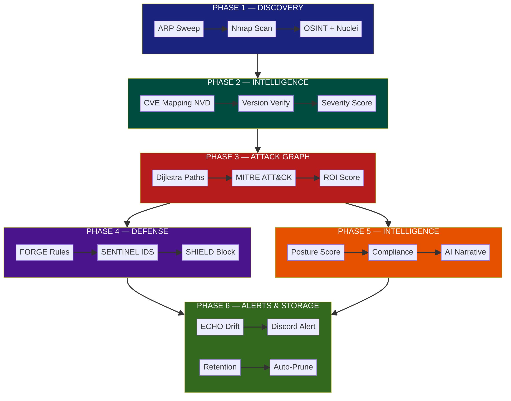

<div align="center">
  <pre>

 █████╗  ██████╗  ██████╗  ██╗ ██████╗  ██╗  █████╗  ██████╗
██╔══██╗ ██╔══██╗ ██╔════╝ ██║ ██╔══██╗ ██║ ██╔══██╗ ██╔════╝
██║  ██║ ██████╔╝ ██████╗  ██║ ██║  ██║ ██║ ██║  ██║ ██████╗
██║  ██║ ██╔══██╗ ╚═══██╗  ██║ ██║  ██║ ██║ ██║  ██║ ╚═══██╗
╚██████╔ ██████╔╝ ██████╔╝ ██║ ██████╔╝ ██║ ╚██████╔╝██████╔╝
 ╚═════╝  ╚═════╝  ╚═════╝  ╚═╝ ╚═════╝  ╚═╝  ╚═════╝  ╚═════╝

  </pre>

  <h1>OBSIDIOS — Autonomous Predictive Network Security Platform</h1>

  <p>
    <strong>OBSIDIOS · Real-time host discovery · AI-driven vulnerability mapping · Attack path simulation · 3D tactical dashboard · Automated defense</strong>
  </p>

  <p>
    <a href="#"></a>
    <a href="#"></a>
    <a href="#"></a>
    <a href="#"></a>
  </p>
</div>

---

## Overview

OBSIDIOS is an autonomous network security platform that continuously discovers hosts, maps vulnerabilities via AI-powered CVE enrichment, simulates attack paths against MITRE ATT&CK, generates Suricata IDS rules, and provides real-time defense through a 3D tactical command center.

It runs as a set of Docker containers and requires zero manual intervention once configured.

---

## Architecture

```
┌─────────────────────────────────────────────────────────────────┐
│                         OBSIDIOS PLATFORM                        │
├────────────┬───────────┬───────────┬───────────┬────────────────┤
│   IRIS     │  ORACLE   │  PHANTOM  │  SENTINEL │    DASHBOARD   │
│  Scanning  │   Intel   │  Attack   │  / SHIELD │    3D Web UI   │
│  Discovery │   AI      │   Paths   │  Defense  │  (Three.js)    │
├────────────┼───────────┼───────────┼───────────┼────────────────┤
│ ARP Sweep  │ CVE       │ Dijkstra  │ Suricata  │ Flask +        │
│ Nmap       │ Posture   │ MITRE     │ IDS       │ SocketIO       │
│ OSINT      │ Patch     │ ATT&CK    │ iptables  │ Real-time      │
│ CVE Map    │ Threat    │ ROI       │ Auto-     │ 3D Map         │
│ Nuclei     │ Intel     │ Scoring   │ block     │ Tactical Feed  │
└────────────┴───────────┴───────────┴───────────┴────────────────┘
```

### Core Subsystems

| Module | Purpose |
|--------|---------|
| **IRIS** | Network scanning: ARP heartbeat, Nmap fingerprinting, CVE mapping (NVD API), OSINT, Nuclei template scanning, wireless scanning |
| **ORACLE** | Strategic intelligence: compliance (PCI-DSS/HIPAA/SOC2/NIST), patch prioritization, posture scoring, AI narratives (NVIDIA/OpenRouter/Anthropic) |
| **PHANTOM** | Attack path simulation: Dijkstra shortest-path on attack graph, MITRE ATT&CK technique mapping, attacker ROI scoring |
| **FORGE** | Suricata IDS rule generation from PHANTOM attack paths |
| **SENTINEL** | Suricata-based intrusion detection: spawns Suricata, tails eve.json, cross-references alerts with PHANTOM paths, triggers SHIELD |
| **SHIELD** | Adaptive defense: iptables-based IP blocking, path isolation, micro-segmentation, automatic quarantine |
| **ECHO** | Behavioral drift detection: Z-score anomaly detection on network traffic patterns |
| **CHRONICLE** | Database layer: SQLite via aiosqlite, 15+ table schema, WAL mode, FK enforcement, connection pooling |
| **ALERTS** | Discord notification system: buffered & consolidated alerts for CVEs, attack paths, intrusions, wireless threats, scan events |
| **DASHBOARD** | Flask + SocketIO web UI with Three.js 3D tactical map, real-time network stats, JWT authentication, 12+ API endpoints |

---

## Quick Start

### Prerequisites

- Docker & Docker Compose
- Linux host with `iptables` and `nftables` (for SHIELD defense features)
- Network interface in the target subnet (for ARP scanning)

### 1. Clone & Configure

```bash
git clone https://github.com/idkgarvit/OBSIDIOS.git
cd OBSIDIOS
cp config/.env.example .env
```

Edit `.env` to configure optional settings:

```env
# At least one AI provider key recommended:
NVIDIA_API_KEY=nvapi-...         # Primary: NVIDIA meta/llama-3.1-8b-instruct (free tier ~20 req/min)
OPENROUTER_API_KEY=sk-or-v1-...  # OpenAI-compatible provider (OPENAI_API_KEY also works)
ANTHROPIC_API_KEY=sk-ant-...     # Last resort fallback

# Optional integrations:
OBSIDIOS_DISCORD_WEBHOOK=https://discord.com/api/webhooks/...  # Alert notifications
SHODAN_API_KEY=...    # OSINT enrichment
MSF_PASSWORD=...      # Metasploit RPC (if used)

# Load generated rules into Suricata after each rewrite:
FORGE_RELOAD_CMD=suricatasc -c reload-rules /var/run/suricata/suricata-command.socket
```

`.env` is loaded at startup. Real environment variables always win, so container or systemd settings are never overridden by the file. `config/.env.example` documents every option.

> **Auto-detection:** OBSIDIOS auto-detects your target network via the dashboard UI — no need to set `OBSIDIOS_TARGET` in `.env`. All configuration (target, scan profile, scheduling) can be managed from the dashboard.

### 2. Launch

```bash
sudo docker-compose up -d --build
```

This starts:
- `obsidios-daemon` — scanning engine (privileged, host network)
- `obsidios-dash` — web dashboard on port 8080
- `obsidios-echo` — behavioral drift detection
- `obsidios-sentinel` — Suricata IDS + SHIELD auto-defense
- `caddy-proxy` — optional reverse proxy with TLS

### 3. Access Dashboard

Navigate to **http://localhost:8080**. The dashboard binds to `127.0.0.1` by default; expose it on a LAN only with `python3 obsidios.py dash --host 0.0.0.0` and put it behind the bundled Caddy proxy or a VPN.

Dev credentials: `admin` / `obsidios123` (dev only — production refuses defaults; set `DASHBOARD_PASS`, optional `VIEWER_USER`/`VIEWER_PASS`; auth is a 15-minute access token plus a 7-day HttpOnly refresh cookie issued by `POST /api/v2/login`)

### 4. Configure & Start Scanning

The scanner starts in **paused** mode. To begin scanning:

1. Go to **Network Config** in the sidebar
2. **Detect** your network (auto-detects your local subnet) or enter a target CIDR manually
3. Select a **Scan Profile** (FAST / STEALTH / GHOST)
4. Click **Apply** — scanning starts immediately

The daemon will begin ARP host discovery, Nmap fingerprinting, CVE mapping, and attack path simulation. You can monitor progress on the **Overview** dashboard.

> To pause or stop scanning at any time, toggle the scanner switch in **Network Config** or use the command: `python3 obsidios.py config set-scanner off`

Scheduled scans (Network Config → Schedule) use the daemon host's **local timezone**. The time field, the displayed next run, and the scheduler all read the same clock; hourly schedules are anchored to daemon start and ignore the time-of-day field.

---

## Configuration

### Scan Profiles

| Profile | Args | Duration | Use Case |
|---------|------|----------|----------|
| `FAST` | `-sV -O -T4 --top-ports 100` | ~30 sec | Lab / trusted network |
| `STEALTH` | `-sS -sV -f -D RND:10 -T2` | ~15-20 min | Production / firewalled |
| `GHOST` | `-sS -sV -f -D RND:20 -T1 -p-` | ~2-4 hours | Maximum evasion, all ports |
| `STEALTH_IDLE` | Zombie-assisted idle scan | Varies | Stealthiest option |

### Environment Variables

| Variable | Default | Description |
|----------|---------|-------------|
| `OBSIDIOS_TARGET` | auto-detected | Target CIDR network (optional — auto-detected by dashboard) |
| `OBSIDIOS_SCAN_INTERVAL` | `3600` | Seconds between scans |
| `OBSIDIOS_SCAN_PROFILE` | `FAST` | Scan profile name |
| `OBSIDIOS_GATEWAY` | `192.168.1.1` | Gateway IP for latency measurement |
| `NVIDIA_API_KEY` | — | Primary AI provider: NVIDIA meta/llama-3.1-8b-instruct |
| `OPENROUTER_API_KEY` | — | OpenAI-compatible AI provider (OpenRouter); alias of `OPENAI_API_KEY` |
| `OPENAI_API_KEY` | — | Same provider, takes precedence over `OPENROUTER_API_KEY` |
| `ANTHROPIC_API_KEY` | — | Last resort AI fallback |
| `OBSIDIOS_AI_FRESHNESS_HOURS` | `24` | How much scan history ORACLE will analyse before asking for a fresh scan |
| `SHODAN_API_KEY` | — | Shodan API key for OSINT |
| `OBSIDIOS_DISCORD_WEBHOOK` | — | Discord webhook for consolidated alerts |
| `MSF_PASSWORD` | — | Metasploit RPC password |
| `OBSIDIOS_SECRET` | auto-generated | Flask session / JWT signing key |
| `DASHBOARD_USER` / `DASHBOARD_PASS` | `admin` / dev default | Operator login; production refuses the dev default |
| `VIEWER_USER` / `VIEWER_PASS` | — | Optional read-only dashboard account |
| `OBSIDIOS_ENV` | `dev` | Set `production` to enforce TLS/cookie/secret guardrails |
| `OBSIDIOS_TRUST_PROXY` | `0` | Trust `X-Forwarded-For` (only behind Caddy/VPN) |
| `OBSIDIOS_ALLOW_PUBLIC_SCAN` | `0` | Permit targets outside RFC1918/link-local space |
| `SHIELD_DRY_RUN` | `1` | Log blocks without touching iptables |
| `SHIELD_AUTO_QUARANTINE` | `0` | Allow ECHO anomalies to trigger blocks automatically |
| `SHIELD_ALLOWLIST` | — | Comma-separated IPs/CIDRs that can never be blocked |
| `OBSIDIOS_METRICS_TOKEN` | — | Bearer token for `GET /metrics` |
| `OBSIDIOS_METRICS_PUBLIC` | `0` | Explicitly expose `/metrics` without a token |
| `OBSIDIOS_OFFLINE_GRACE_SECONDS` | `1.5 × interval` | Grace before a host is marked offline |

---

## CLI Commands

```bash
python3 obsidios.py --help
```

| Command | Description |
|---------|-------------|
| `run` | Full autonomous scan cycle (continuous) |
| `scan` | Single scan pass, output to terminal |
| `dash` | Launch web dashboard (via gunicorn) |
| `status` | Strategic HUD in terminal |
| `audit <framework>` | Compliance audit (PCI-DSS, HIPAA, SOC2, NIST) |
| `remediation` | AI-prioritized patch roadmap |
| `phantom` | View predicted attack kill-chains |
| `shield` | View/manage active blocks |
| `iris` | View OSINT & wireless intelligence |
| `sentinel` | Start Suricata IDS pipeline |
| `echo` | Run behavioral drift detection |
| `config show` | Show current configuration |
| `config set-target` | Set target CIDR |
| `config set-profile` | Set scan profile |
| `config set-scanner` | Enable (`on`) or pause (`off`) scanning |
| `start` | God mode: engine + dashboard + war room |
| `hub` | Integrated terminal intelligence console |

---

## API Endpoints (Dashboard)

The Flask dashboard exposes a JSON API under `/api/v2/` with JWT Bearer authentication. Obtain an access token with `POST /api/v2/login`; the same response sets an HttpOnly, SameSite=Strict `obsidios_refresh` cookie scoped to `/api/v2`. Change defaults via `DASHBOARD_USER`/`DASHBOARD_PASS` and optional read-only `VIEWER_USER`/`VIEWER_PASS` in `.env`:

| Endpoint | Description |
|----------|-------------|
| `POST /api/v2/login` | Issue a 15-minute access token + 7-day refresh cookie |
| `POST /api/v2/refresh` | Rotate the refresh cookie and issue a new access token |
| `POST /api/v2/logout` | Revoke the current access/refresh tokens and clear the cookie |
| `GET  /api/health` | Unauthenticated liveness probe (Docker healthcheck) |
| `GET  /api/v2/stats` | Dashboard overview statistics |
| `GET  /api/v2/context` | Operator context banner: target, profile, scanner/scan state, SHIELD mode, unacknowledged alerts, active blocks, identity |
| `GET  /api/v2/graph` | 3D attack graph data (nodes + simplified edges) |
| `GET  /api/v2/cves` | All CVEs with severity, verification status |
| `GET  /api/v2/offensive/attack_vectors` | Attack paths with MITRE mapping |
| `GET  /api/v2/oracle/ai_brief` | AI-generated strategic summary (5-min cache) |
| `GET  /api/v2/oracle/compliance` | Compliance posture (PCI-DSS/HIPAA/SOC2/NIST) |
| `GET  /api/v2/oracle/patch_priority` | Patch prioritization by CVSS + exploitability |
| `GET  /api/v2/sentinel/alerts` | Suricata IDS alerts |
| `POST /api/v2/sentinel/alerts/<id>/ack` | Acknowledge one SENTINEL alert (operator) |
| `POST /api/v2/sentinel/alerts/ack_all` | Acknowledge every open SENTINEL alert (operator) |
| `GET  /api/v2/shield/actions` | Active SHIELD blocks |
| `GET  /api/v2/forge/rules` | Generated Suricata rules plus the last delivery attempt (`delivery.state`: `DEPLOYED`, `WRITTEN`, `WRITTEN_NO_RELOAD`, `FAILED`, `EMPTY`) |
| `POST /api/v2/forge/deploy/<id>` | Include/exclude one rule and rewrite + reload the live ruleset (operator) |
| `POST /api/v2/forge/rewrite` | Re-render the ruleset from active rules and reload the sensor (operator) |
| `GET  /api/v2/details/hosts` | Detailed host inventory |
| `GET  /api/v2/details/host` | Full drill-down for one host by `?ip=` — fingerprint, ports, CVEs, detections, shield actions (400 on a bad IP, 404 when unknown) |
| `GET  /api/v2/details/ports` | Detailed port inventory (`?state=open\|filtered\|closed\|all`; default `open`) |
| `GET  /api/v2/audit/timeline` | Unified chronological audit feed: scans, SENTINEL alerts, SHIELD actions and FORGE rules (`?limit=1..500`, default 100) |
| `GET  /api/v2/audit/log` | Operator audit trail: who changed what, when, from which IP (`?limit=1..500`, default 200; optional `action`, `actor`; operator-only) |
| `GET  /api/v2/network/stats` | Real-time network activity (rx/tx, latency, pkt/s) |
| `GET  /api/v2/metrics` | Prometheus metrics (requires `OBSIDIOS_METRICS_TOKEN`) |
| `GET  /api/v2/system/retention` | Current data retention setting (days) |
| `POST /api/v2/system/retention` | Update data retention setting (operator) |
| `POST /api/v2/system/prune` | Prune data older than retention days (operator) |
| `POST /api/v2/export/pdf` | Export HTML + PDF pentest report |
| `POST /api/v2/actions/cancel_scan` | Cancel active scan (operator) |
| `POST /api/v2/cves/reverify` | Re-run CVE version verification (operator) |

Authentication: send `Authorization: Bearer <access-token>`. Refresh tokens are never returned in JSON; browsers send the cookie automatically to `/api/v2/refresh`. Viewer accounts are read-only — every mutating endpoint requires the operator role. The legacy `POST /api/login` alias remains for older clients and issues the same token pair.

### Investigation Deep Links

The dashboard is a single page with hash routing, so any finding can be linked, bookmarked, or pasted into a ticket:

| Link | Opens |
|------|-------|
| `/#page=sentinel` | Any dashboard page by id |
| `/#host=192.168.1.77` | Host inventory with the drill-down drawer for that IP |
| `/#cve=CVE-2024-3094` | Vulnerabilities page pre-filtered to one CVE |
| `/#alert=12` | SENTINEL with that alert highlighted and scrolled into view |

Page navigation replaces the history entry; opening an investigation target pushes one, so **Back** closes the drawer or clears the filter. Unknown or malformed hashes are ignored rather than erroring. Host cards, CVE rows, service rows and timeline host links all open the same drawer, which shows fingerprint, ports, CVEs, detections and shield actions — with copy buttons for the IP and the deep link. Viewer accounts see the same evidence with no acknowledge or revert controls.

### FORGE Rule Delivery

FORGE writes a generated ruleset and then asks the sensor to load it. The dashboard reports what actually happened, not what was intended:

| State | Meaning |
|-------|---------|
| `DEPLOYED` | File written **and** the reload command succeeded |
| `WRITTEN` | File written, but `FORGE_RELOAD_CMD` is not configured — Suricata still has the old rules |
| `WRITTEN_NO_RELOAD` | File written, reload command failed (the previous ruleset stays loaded until it is fixed) |
| `FAILED` | Nothing was written; the previous ruleset is untouched |
| `EMPTY` | No active rules to write |

Every rule is validated before it reaches the file (action, protocol, addresses, message, SID range 9000000–9999999, `rev`, balanced quotes/parentheses, no newlines). If any active rule fails validation, **the write is aborted so the known-good ruleset stays live**, the offending rows are quarantined, and the failure is recorded in `forge_delivery` and shown in the UI. A rule is only marked "in sensor" once a ruleset containing it was written.

The reload hook is `FORGE_RELOAD_CMD` (see `config/.env.example`). The Compose deployment shares a `suricata_run` volume and defaults it to `suricatasc -c reload-rules /var/run/suricata/suricata-command.socket`; the socket is enabled in `sentinel/suricata.yaml`. Leave the variable empty to write rules without reloading.

### Operator Audit Trail

Every state-changing action is appended to the `audit_log` table (schema v4) with the authenticated actor, role, action, target, detail, client IP and outcome:

```
AUTH_LOGIN  AUTH_LOGIN_FAILED  AUTH_LOGOUT
TARGET_UPDATE  TARGET_SAVE  TARGET_USE  SCHEDULE_UPDATE
SCAN_TRIGGER  SCAN_CANCEL  SCANNER_TOGGLE  WIRELESS_SCAN
SHIELD_REVERT  SENTINEL_ACK  SENTINEL_ACK_ALL
CVE_DISMISS  CVE_REVERIFY  DATA_PRUNE  RETENTION_UPDATE  ALERT_CONFIG
FORGE_RULE_EDIT  FORGE_REWRITE  FORGE_FEEDBACK  EXPORT_REPORT
```

Audit writes are best-effort: if the audit insert fails, the operator's action still succeeds and a warning is logged. Failed actions (for example a SHIELD rollback that could not remove the iptables rule) are recorded with `outcome=failure` instead of being silently dropped. Records older than 365 days are pruned opportunistically.

The **Audit Log** page in the dashboard (sidebar → Governance) shows the trail with filters for actor, action, text and outcome; entries whose target is an IP link into the host drill-down. The endpoint is operator-only — viewer accounts get `403`, because the trail contains usernames, addresses and configuration details. Export the table directly if you need it for a compliance review.

---

## Features

### Discord Alerts
14 alert types with buffered & consolidated embeds: critical CVEs, exploit rules, wireless threats, sentinel intrusions, scan events, forge rules. Cooldown per source-destination pair prevents alert storms. Single webhook endpoint.

### AI Provider Chain
Automatic failover: **NVIDIA** (meta/llama-3.1-8b-instruct, free tier) → **OpenRouter** (liquid/lfm-2.5-1.2b-instruct:free) → **Anthropic** (Claude). Powers AI briefs, compliance audits, patch prioritization, and CVE narratives.

### 3D Tactical Dashboard
<p align="center">
  
</p>
Three.js-based 3D network topology with gravity-bound nodes, attack-highlight edges, host color-by-risk. Real-time network activity chart (rx/tx/latency). Survives page navigation without losing chart state.

### Data Retention
Configurable retention period (1–365 days, default 30). Auto-prune at scan cycle end. Persistent setting stored in DB, configurable via dashboard UI.

---

## Workflow

<p align="center">
  
</p>

> *Click and open the image in a new tab for full resolution.*

## Troubleshooting

### Container Issues

| Problem | Likely Cause | Fix |
|---------|-------------|-----|
| Container exits immediately | Missing capabilities or `--network host` | Ensure `docker-compose.yml` has `cap_add: [NET_RAW, NET_ADMIN]` and `network_mode: host` for daemon/sentinel |
| `obsidios-dash` won't start | Port 8080 already in use | `lsof -ti:8080 \| xargs kill` or change port in `.env` |
| Permission denied on `/proc/net/dev` | Container lacks `--network host` | Add `network_mode: host` to dashboard service |

### Scanning Problems

| Problem | Likely Cause | Fix |
|---------|-------------|-----|
| No hosts discovered | Wrong network interface or target | Go to **Network Config** → click **Detect** to auto-detect your subnet |
| ARP sweep finds 0 hosts | Interface not in target subnet | Verify with `ip addr`; bind mount the correct interface |
| Nmap scan hangs | Firewall blocking probes | Use `STEALTH` profile (`-T2 -f -D RND:10`) or whitelist OBSIDIOS in your firewall |
| Wireless scan shows nothing | No wireless interface | Run `iw dev` on host to verify; OBSIDIOS auto-detects if interface exists |
| Scanning won't start | Scanner starts in **paused** mode | Click **Start Scan** in dashboard, or `python3 obsidios.py config set-scanner on` |

### CVE / Intel Issues

| Problem | Likely Cause | Fix |
|---------|-------------|-----|
| No CVEs found | NVD rate limit hit | NVD limits to 5 req/30s without API key; wait or add `NVD_API_KEY` to `.env` |
| CVEs showing but not mapped to specific products | Generic protocol ports (http/80, https/443, tcp/udp) | CVE mapper skips generic protocols when no product detected — expected behavior |
| AI brief shows fallback text | All AI providers failed | Check API keys: `NVIDIA_API_KEY`, `OPENROUTER_API_KEY`, or `ANTHROPIC_API_KEY` |
| AI brief says "No completed scan data" | No scan has completed yet | Run a scan first; AI brief only generates after scan completion |

### Alert / Notification Issues

| Problem | Likely Cause | Fix |
|---------|-------------|-----|
| No Discord alerts | Missing webhook URL | Set `OBSIDIOS_DISCORD_WEBHOOK` in `.env` and restart |
| Duplicate Discord alerts | Cooldown not working | Check `alerts/notifier.py` — sentinel alerts have 60s cooldown per src→dst |
| Discord rate-limited | Too many alerts in short burst | Alerts are consolidated into batches capped at 25 fields per embed; reduce scan churn or raise the cooldown in `notifier.py` |

### Dashboard / UI Issues

| Problem | Likely Cause | Fix |
|---------|-------------|-----|
| Dashboard shows "No data" | Scanner hasn't completed a cycle | Wait for scan to finish, or check `GET /api/v2/stats` directly |
| 3D graph is empty | No hosts discovered | Run ARP detection from **Network Config** page |
| Network activity chart shows flatline | Latency check to gateway failing | Set `OBSIDIOS_GATEWAY` env var to your actual gateway IP; verify gateway responds on port 80 |
| "401 Unauthorized" on API calls | 15-minute access token expired | The SPA refreshes automatically; for scripts re-call `POST /api/v2/login` with the refresh cookie |
| Page navigation kills chart | Fixed — `pollNetworkStats()` now re-initialized on page switch | Ensure you're running latest dashboard code; restart container |

### Sentinel / SHIELD Issues

| Problem | Likely Cause | Fix |
|---------|-------------|-----|
| Suricata won't start | Missing capabilities or host networking | Use `network_mode: host` and `cap_add: [NET_RAW, NET_ADMIN]` (the reference compose file already does) |
| SHIELD can't block IPs | Missing `NET_ADMIN` capability, dry-run enabled, or iptables not installed | Check `SHIELD_DRY_RUN=0`, grant `NET_ADMIN`/`NET_RAW`, and install `iptables` |
| No sentinel alerts despite Suricata running | Rules were written but the sensor never reloaded | Check the FORGE page banner. `WRITTEN — NO RELOAD CONFIGURED` means set `FORGE_RELOAD_CMD`; `WRITTEN — RELOAD FAILED` shows the command output. The ruleset lives at `forge/rules/suricata.rules` (`/app/forge/rules/suricata.rules` in containers) |

### Database Issues

| Problem | Likely Cause | Fix |
|---------|-------------|-----|
| `database is locked` errors | Multiple concurrent writes | Restart daemon container; ensures single writer |
| Data not persisting across restarts | Volume not mounted | Ensure `chronicle/obsidios.db` is on a bind mount or Docker volume |
| Foreign key constraint errors | Data integrity issue | Should be handled automatically — run a fresh scan to rebuild related records |

### General

| Problem | Likely Cause | Fix |
|---------|-------------|-----|
| Container logs show Python errors | Missing dependency or version conflict | Rebuild: `docker compose build` then `docker compose up -d` |
| Host has no wireless hardware | Expected for desktop/VMs | OBSIDIOS handles gracefully — shows "No wireless threats detected" with hint |
| OBSIDIOS_SECRET not set warning | No secret key configured | Set `OBSIDIOS_SECRET` to a random string in `.env` for production use |

- OBSIDIOS requires **NET_RAW/NET_ADMIN capabilities** (not `--privileged`) for ARP scanning and iptables; the reference compose file drops all other capabilities
- Always deploy in an isolated network segment
- Change default dashboard credentials (`admin` / `obsidios123`) in production
- Set `OBSIDIOS_SECRET` to a strong random value in production
- Set `MSF_PASSWORD` to a strong password if using Metasploit RPC
- API keys (`NVIDIA_API_KEY`, `OPENROUTER_API_KEY`, `SHODAN_API_KEY`) should be rotated regularly
- CVE data is retrieved from NVD (rate-limited to 5 req/30s without API key)
- The `.env` file contains secrets — ensure it's never committed (included in `.gitignore`)
- Generated files (`reports/output/*`, `forge/rules/*`) may contain local IPs — excluded from version control

---

## Contributing

See [CONTRIBUTING.md](CONTRIBUTING.md) for guidelines.

## License

[MIT](LICENSE)

---

<div align="center">
  <sub>Built for research and defensive security purposes. Use responsibly.</sub>
</div>
