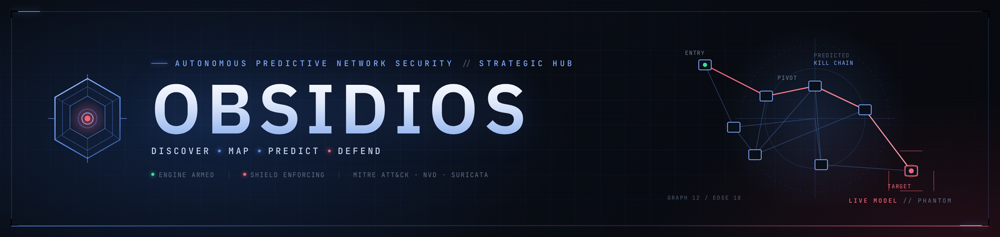
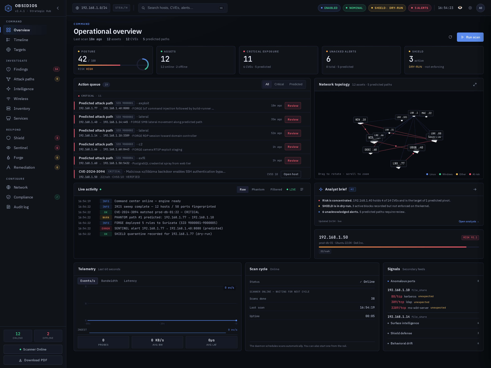
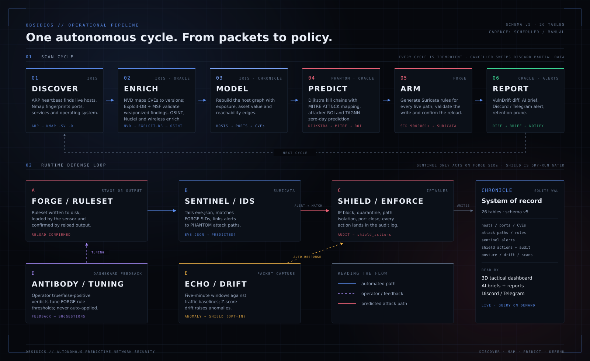

<div align="center">
  

  <h1>Autonomous Predictive Network Security Platform</h1>

  <p>
    <strong>Real-time host discovery · AI-driven vulnerability mapping · Attack path simulation · 3D tactical dashboard · Automated defense</strong>
  </p>

  <p>
    <a href="#"></a>
    <a href="#"></a>
    <a href="#"></a>
    <a href="#"></a>
  </p>
</div>

---

## Overview

OBSIDIOS is an autonomous network security platform that discovers hosts, maps vulnerabilities through NVD plus AI-assisted analysis, simulates attack paths against MITRE ATT&CK, generates Suricata IDS rules, and provides real-time defense through a 3D tactical command center.

It runs as a set of Docker containers on a Linux host with access to the monitored network. Scanning starts **paused** by design: set a target (or enable the scanner) in the dashboard before the first sweep.

The current build contains:

- **26 SQLite tables** (schema version 5) managed by CHRONICLE
- **58 HTTP routes** — 56 under `/api` and `/api/v2`, plus `/` and `/metrics`
- **4 Discord alert categories** with batched delivery and per-pair cooldowns
- **18 CLI commands** with an interactive tactical shell and War Room

---

## Architecture

```
┌─────────────────────────────────────────────────────────────────┐
│                         OBSIDIOS PLATFORM                        │
├────────────┬───────────┬───────────┬───────────┬────────────────┤
│   IRIS     │  ORACLE   │  PHANTOM  │  SENTINEL │    DASHBOARD   │
│  Scanning  │   Intel   │  Attack   │ / SHIELD  │    3D Web UI   │
│  Discovery │    AI     │   Paths   │  Defense  │   (Three.js)   │
├────────────┼───────────┼───────────┼───────────┼────────────────┤
│ ARP Sweep  │ CVE       │ Dijkstra  │ Suricata  │ Flask +        │
│ Nmap       │ Posture   │ MITRE     │ IDS       │ SocketIO       │
│ OSINT      │ Patch     │ ATT&CK    │ iptables  │ Real-time      │
│ CVE Map    │ Compliance│ ROI       │ Auto-     │ 3D Map         │
│ Nuclei     │ AI Brief  │ Scoring   │ block     │ Tactical Feed  │
└────────────┴───────────┴───────────┴───────────┴────────────────┘
```

### Core Subsystems

| Module | Purpose |
|--------|---------|
| **IRIS** | Network scanning: ARP heartbeat, Nmap fingerprinting, CVE mapping (NVD API), OSINT, Nuclei template scanning, wireless scanning |
| **ORACLE** | Strategic intelligence: compliance (PCI-DSS/HIPAA/SOC2/NIST), patch prioritization, posture scoring, AI narratives (NVIDIA/OpenRouter/Anthropic) |
| **PHANTOM** | Attack path simulation: Dijkstra shortest-path on the attack graph, MITRE ATT&CK technique mapping, attacker ROI scoring |
| **FORGE** | Suricata IDS rule generation from PHANTOM attack paths, with validated writes and reload reporting |
| **SENTINEL** | Suricata-based intrusion detection: tails `eve.json`, cross-references alerts with PHANTOM paths, triggers SHIELD |
| **SHIELD** | Adaptive defense: iptables-based IP blocking, path isolation, micro-segmentation, port closure, automatic quarantine |
| **ECHO** | Behavioral drift detection: Z-score anomaly detection on network traffic patterns |
| **ANTIBODY** | Learning loop: true/false-positive feedback tunes generated rule thresholds |
| **CHRONICLE** | Database layer: SQLite via aiosqlite, 26-table schema, WAL mode, foreign-key enforcement, connection pooling |
| **ALERTS** | Discord and Telegram delivery: buffered, consolidated alerts for critical CVEs, exploit rules, wireless threats, and SENTINEL intrusions |
| **DASHBOARD** | Flask + SocketIO web UI with a Three.js 3D tactical map, real-time stats, JWT authentication, and 58 routes |

---

## Quick Start

### Prerequisites

- Docker Engine with Docker Compose v2 (`docker compose`, not the legacy `docker-compose` binary)
- A Linux host with `iptables` and `nftables` (for SHIELD defense features)
- A network interface in the target subnet (for ARP scanning)
- Python 3.13, `nmap`, and Pango/Cairo libraries if you run the CLI or dashboard outside Docker

### 1. Clone & Configure

```bash
git clone https://github.com/idkgarvit/OBSIDIOS.git
cd OBSIDIOS
cp config/.env.example .env
```

Edit `.env` to configure optional settings:

```env
# At least one AI provider key is recommended:
NVIDIA_API_KEY=nvapi-...         # Primary: NVIDIA meta/llama-3.1-8b-instruct (free tier)
OPENROUTER_API_KEY=sk-or-v1-...  # OpenAI-compatible provider (OPENAI_API_KEY also works)
ANTHROPIC_API_KEY=sk-ant-...     # Fallback provider

# Optional integrations:
OBSIDIOS_DISCORD_WEBHOOK=https://discord.com/api/webhooks/...  # Alert notifications
SHODAN_API_KEY=...    # OSINT enrichment
NVD_API_KEY=...       # Raises the NVD rate limit from 5 req/30s

# Load generated rules into Suricata after each rewrite:
FORGE_RELOAD_CMD=suricatasc -c reload-rules /var/run/suricata/suricata-command.socket
```

`.env` is loaded at startup. Real environment variables always win, so container or systemd settings are never overridden by the file. `config/.env.example` documents the supported options.

> **Auto-detection:** the dashboard can detect the local subnet for you. `OBSIDIOS_TARGET` is only the initial/default scope used until a target is set or detected.

### 2. Launch

```bash
sudo docker compose up -d --build
```

This starts five services:

- `obsidios-daemon` — scanning engine (host networking, `NET_RAW`/`NET_ADMIN`)
- `obsidios-dash` — web dashboard on port 8080
- `obsidios-echo` — behavioral drift detection
- `obsidios-sentinel` — Suricata IDS + SHIELD auto-defense
- `caddy-proxy` — reverse proxy with TLS and security headers

### 3. Access Dashboard

Navigate to **http://localhost:8080** (or through the bundled Caddy proxy). The dashboard binds to `127.0.0.1` by default; for remote access, keep that bind and go through Caddy or a VPN instead of exposing the dashboard directly.

Dev credentials: `admin` / `obsidios123` (dev only — production refuses defaults; set `DASHBOARD_PASS`, optional `VIEWER_USER`/`VIEWER_PASS`; auth is a 15-minute access token plus a 7-day HttpOnly refresh cookie issued by `POST /api/v2/login`).

### 4. Configure & Start Scanning

The scanner starts in **paused** mode on every daemon start. To begin scanning:

1. Go to **Network Config** in the sidebar.
2. **Detect** your network (auto-detects the local subnet) or enter a target CIDR manually.
3. Select a **Scan Profile** (FAST / STEALTH / GHOST / STEALTH_IDLE).
4. Click **Apply** — scanning starts immediately.

The daemon will begin ARP host discovery, Nmap fingerprinting, CVE mapping, and attack path simulation. Monitor progress on the **Overview** dashboard.

> To pause or stop scanning at any time, toggle the scanner switch in **Network Config** or run `python3 obsidios.py config set-scanner off`. Pausing stops every scan path, including the 15-second heartbeat sweep and scheduled cycles.

Scheduled scans (Network Config → Schedule) use the daemon host's **local timezone**. The time field, the displayed next run, and the scheduler all read the same clock; hourly schedules are anchored to daemon start and ignore the time-of-day field.

---

## Configuration

### Scan Profiles

Profiles are defined in `config/settings.py` and can be overridden with `OBSIDIOS_NMAP_ARGS`.

| Profile | Nmap arguments | Use Case |
|---------|----------------|----------|
| `FAST` | `-sV -O -T4 --min-parallelism 20 --max-retries 1 --top-ports 100` | Lab / trusted network |
| `STEALTH` | `-sS -sV -O -Pn -f --mtu 24 -D RND:10 --source-port 53 -T2 --scan-delay 2s --max-retries 2 --top-ports 1000` | Production / firewalled |
| `GHOST` | `-sS -sV -O -Pn -f --mtu 24 -D RND:20 --source-port 53 --badsum -T1 --scan-delay 5s --max-retries 1 -p-` | Maximum evasion, all ports |
| `STEALTH_IDLE` | `-sS -sV -O -Pn -f --mtu 24 --source-port 53 -T2 --scan-delay 3s --max-retries 2 --top-ports 1000 -sI ZOMBIE` | Zombie-assisted idle scan (`OBSIDIOS_ZOMBIE_HOST`) |

Unsafe flags (`--script`, `-iL`, output-file options, shell metacharacters) are rejected before Nmap runs.

### Environment Variables

| Variable | Default | Description |
|----------|---------|-------------|
| `OBSIDIOS_ENV` | `dev` | Set `production` to enforce secret, cookie, TLS, and credential guardrails |
| `OBSIDIOS_SECRET` | dev fallback | JWT/session signing key; required (32+ random characters) in production |
| `OBSIDIOS_TARGET` | `192.168.1.0/24` | Initial scan scope until a target is set in the dashboard |
| `OBSIDIOS_SCAN_INTERVAL` | `3600` | Seconds between scheduled scans |
| `OBSIDIOS_SCAN_PROFILE` | `FAST` | `FAST`, `STEALTH`, `GHOST`, or `STEALTH_IDLE` |
| `OBSIDIOS_SCAN_CONCURRENCY` | `20` | Concurrent host scans |
| `OBSIDIOS_NMAP_ARGS` | — | Override the active profile's Nmap arguments |
| `OBSIDIOS_ZOMBIE_HOST` | — | Zombie host for `STEALTH_IDLE` |
| `OBSIDIOS_ALLOW_BROAD_SCAN` | `0` | Permit prefixes broader than /16 (minimum /8); authorisation required |
| `OBSIDIOS_ALLOW_PUBLIC_SCAN` | `0` | Permit targets outside private/link-local space |
| `OBSIDIOS_GATEWAY` | `192.168.1.1` | Default gateway; also protected from SHIELD blocks |
| `OBSIDIOS_CAPTURE_IFACE` | `eth0` | Interface ECHO and network stats read |
| `OBSIDIOS_OFFLINE_GRACE_SECONDS` | `1.5 × interval` | Grace before a host is marked offline (minimum 300 s) |
| `OBSIDIOS_FAST_OFFLINE_GRACE_SECONDS` | `120` | Grace for the 15-second heartbeat sweep |
| `OBSIDIOS_MAC_VENDORS` | — | Optional MAC-vendor database path |
| `OBSIDIOS_NUCLEI_TIMEOUT` | `1800` | Nuclei scan timeout in seconds |
| `OBSIDIOS_WIRELESS` | `1` | Enable wireless scanning |
| `OBSIDIOS_WLAN_IFACE` | `wlan0` | Wireless interface |
| `NVD_API_KEY` | — | NVD API key (raises the limit from 5 req/30s) |
| `SHODAN_API_KEY` | — | Shodan API key for OSINT |
| `NVIDIA_API_KEY` / `NVIDIA_BASE_URL` / `NVIDIA_MODEL` | — / NVIDIA endpoint / `meta/llama-3.1-8b-instruct` | Primary AI provider |
| `OPENROUTER_API_KEY` | — | OpenAI-compatible provider (alias of `OPENAI_API_KEY`) |
| `OPENAI_API_KEY` / `OPENAI_BASE_URL` / `OPENAI_MODEL` | — / OpenRouter endpoint / `liquid/lfm-2.5-1.2b-instruct:free` | OpenAI-compatible provider; wins over `OPENROUTER_API_KEY` |
| `ANTHROPIC_API_KEY` | — | Anthropic fallback |
| `OBSIDIOS_AI_MODEL` | `claude-opus-4-5` | Model name for the Anthropic provider |
| `OBSIDIOS_AI_FRESHNESS_HOURS` | `24` | Maximum age of scan data ORACLE will analyse (capped at 720 h) |
| `OBSIDIOS_DISCORD_WEBHOOK` | — | Discord webhook for consolidated alerts |
| `OBSIDIOS_TELEGRAM_TOKEN` / `OBSIDIOS_TELEGRAM_CHAT` | — | Telegram bot token and chat ID |
| `DASHBOARD_USER` / `DASHBOARD_PASS` | `admin` / dev default | Operator login; production refuses the dev default |
| `VIEWER_USER` / `VIEWER_PASS` | — | Optional read-only dashboard account |
| `OBSIDIOS_DASH_HOST` / `OBSIDIOS_DASH_PORT` | `127.0.0.1` / `8080` | Dashboard bind address and port |
| `OBSIDIOS_DASH_DEBUG` | `0` | Must stay `0` in production |
| `CORS_ORIGINS` | `http://localhost:8080,http://127.0.0.1:8080` | Comma-separated Socket.IO origins |
| `OBSIDIOS_TRUST_PROXY` | `0` | Trust `X-Forwarded-For` (only behind Caddy/VPN) |
| `OBSIDIOS_METRICS_TOKEN` | — | Bearer token for `GET /metrics` |
| `OBSIDIOS_METRICS_PUBLIC` | `0` | Explicitly expose `/metrics` without a token |
| `SHIELD_DRY_RUN` | `1` | Log intended blocks without touching iptables |
| `SHIELD_AUTO_QUARANTINE` | `0` | Allow ECHO anomalies to trigger blocks automatically |
| `SHIELD_ALLOWLIST` | — | Comma-separated IPs/CIDRs that can never be blocked |
| `SHIELD_MAX_ACTIONS_PER_HOUR` | `10` | Block-storm cap |
| `IPTABLES_BIN` | `iptables` | Override the iptables binary |
| `FORGE_RULES_PATH` | `forge/rules/suricata.rules` | Generated ruleset path |
| `FORGE_RELOAD_CMD` | Compose default | Command run after a successful write; leave empty to skip reload |
| `OBSIDIOS_STRICT_DIRS` | — | Fail fast instead of warning when a runtime directory cannot be created |

---

## CLI Commands

```bash
python3 obsidios.py --help
```

| Command | Description |
|---------|-------------|
| `run` | Full autonomous scan cycle (continuous) |
| `scan` | Single scan pass, output to terminal |
| `dash` | Launch the web dashboard under Gunicorn (`--host` / `--port`) |
| `start` | God mode: engine + dashboard + War Room |
| `hub` | Integrated terminal intelligence console |
| `shell` | Interactive tactical shell |
| `status` | Strategic HUD in terminal |
| `trigger` | Manually trigger a full intelligence cycle |
| `audit <framework>` | Compliance audit (PCI-DSS, HIPAA, SOC2, NIST) |
| `remediation` | AI-prioritized patch roadmap |
| `phantom` | View predicted attack kill-chains |
| `shield [--release IP]` | View/manage active blocks |
| `iris` | View OSINT and wireless intelligence |
| `sentinel` | Start the Suricata IDS pipeline |
| `echo` | Run behavioral drift detection |
| `backup` | Online SQLite backup (WAL-safe) with rotation |
| `restore <file>` | Restore the database from a backup |
| `config show` | Show current configuration |
| `config set-target <cidr>` | Set the active target |
| `config set-profile <profile>` | Set the scan profile |
| `config set-scanner <on\|off>` | Enable or pause scanning |

---

## API Endpoints (Dashboard)

The Flask dashboard exposes 56 API routes under `/api` and `/api/v2` with JWT Bearer authentication. Obtain an access token with `POST /api/v2/login`; the same response sets an HttpOnly, SameSite=Strict `obsidios_refresh` cookie scoped to `/api/v2`. Change defaults via `DASHBOARD_USER`/`DASHBOARD_PASS` and optional read-only `VIEWER_USER`/`VIEWER_PASS` in `.env`.

Selected endpoints:

| Endpoint | Description |
|----------|-------------|
| `POST /api/v2/login` | Issue a 15-minute access token + 7-day refresh cookie |
| `POST /api/v2/refresh` | Rotate the refresh cookie and issue a new access token |
| `POST /api/v2/logout` | Revoke the current access/refresh tokens and clear the cookie |
| `GET /api/health` | Unauthenticated liveness probe (Docker healthcheck) |
| `GET /api/readyz` | Readiness probe including database connectivity |
| `GET /api/v2/stats` | Dashboard overview statistics |
| `GET /api/v2/context` | Operator context banner: target, profile, scanner/scan state, SHIELD mode, unacknowledged alerts, active blocks, identity |
| `GET /api/v2/graph` | 3D attack graph data (nodes + simplified edges) |
| `GET /api/v2/cves` | All CVEs with severity and verification status |
| `GET /api/v2/offensive/attack_vectors` | Attack paths with MITRE mapping |
| `GET /api/v2/oracle/ai_brief` | AI-generated strategic summary (5-minute cache) |
| `GET /api/v2/oracle/compliance` | Compliance posture (PCI-DSS/HIPAA/SOC2/NIST) |
| `GET /api/v2/oracle/patch_priority` | Patch prioritization by CVSS and exploitability |
| `GET /api/v2/sentinel/alerts` | Suricata IDS alerts |
| `POST /api/v2/sentinel/alerts/<id>/ack` | Acknowledge one SENTINEL alert (operator) |
| `POST /api/v2/sentinel/alerts/ack_all` | Acknowledge every open SENTINEL alert (operator) |
| `GET /api/v2/shield/actions` | Active SHIELD blocks |
| `POST /api/v2/shield/revert/<id>` | Revert one SHIELD action (operator) |
| `GET /api/v2/forge/rules` | Generated Suricata rules plus the last delivery attempt |
| `POST /api/v2/forge/deploy/<id>` | Include/exclude one rule and rewrite + reload the live ruleset (operator) |
| `POST /api/v2/forge/rewrite` | Re-render the ruleset from active rules and reload the sensor (operator) |
| `GET /api/v2/details/hosts` | Detailed host inventory |
| `GET /api/v2/details/host` | Full drill-down for one host by `?ip=` |
| `GET /api/v2/details/ports` | Detailed port inventory (`?state=open\|filtered\|closed\|all`) |
| `GET /api/v2/audit/timeline` | Unified chronological audit feed: scans, SENTINEL alerts, SHIELD actions, FORGE rules |
| `GET /api/v2/audit/log` | Operator audit trail (operator-only) |
| `GET /api/v2/config/targets` | Saved target list |
| `POST /api/v2/config/target` | Set the active target and profile |
| `GET /api/v2/config/schedule` | Get the scan schedule |
| `POST /api/v2/config/schedule` | Update the scan schedule |
| `GET /api/network/stats` | Real-time network activity (rx/tx, latency, pkt/s) |
| `GET /api/v2/system/retention` | Current data retention setting (days) |
| `POST /api/v2/system/retention` | Update data retention (1–3650 days) |
| `POST /api/v2/system/prune` | Prune data older than retention days (operator) |
| `POST /api/v2/export/pdf` | Export HTML + PDF pentest report |
| `GET /metrics` | Prometheus metrics (token-gated unless `OBSIDIOS_METRICS_PUBLIC=1`) |

Authentication: send `Authorization: Bearer <access-token>`. Refresh tokens are never returned in JSON; browsers send the cookie automatically to `/api/v2/refresh`. Viewer accounts are read-only — every mutating endpoint requires the operator role. The legacy `POST /api/login` alias remains for older clients and issues the same token pair.

### Investigation Deep Links

The dashboard is a single page with hash routing, so any finding can be linked, bookmarked, or pasted into a ticket:

| Link | Opens |
|------|-------|
| `/#page=sentinel` | Any dashboard page by id |
| `/#host=192.168.1.77` | Host inventory with the drill-down drawer for that IP |
| `/#cve=CVE-2024-3094` | Vulnerabilities page pre-filtered to one CVE |
| `/#alert=12` | SENTINEL with that alert highlighted and scrolled into view |

Page navigation replaces the history entry; opening an investigation target pushes one, so **Back** closes the drawer or clears the filter. Unknown or malformed hashes are ignored rather than erroring. Host cards, CVE rows, service rows, and timeline host links all open the same drawer, which shows fingerprint, ports, CVEs, detections, and shield actions — with copy buttons for the IP and the deep link. Viewer accounts see the same evidence with no acknowledge or revert controls.

### FORGE Rule Delivery

FORGE writes a generated ruleset and then asks the sensor to load it. The dashboard reports what actually happened:

| State | Meaning |
|-------|---------|
| `DEPLOYED` | File written **and** the reload command succeeded |
| `WRITTEN` | File written, but `FORGE_RELOAD_CMD` is not configured — Suricata still has the old rules |
| `WRITTEN_NO_RELOAD` | File written, reload command failed (the previous ruleset stays loaded until it is fixed) |
| `FAILED` | Nothing was written; the previous ruleset is untouched |
| `EMPTY` | No active rules to write |

Every rule is validated before it reaches the file (action, protocol, addresses, message, SID range 9000000–9999999, `rev`, balanced quotes/parentheses, no newlines). If any active rule fails validation, **the write is aborted so the known-good ruleset stays live**, the offending rows are quarantined, and the failure is recorded in `forge_delivery` and shown in the UI. A rule is only marked "in sensor" once a ruleset containing it was written.

The reload hook is `FORGE_RELOAD_CMD` (see `config/.env.example`). The Compose deployment shares a `suricata_run` volume and defaults it to `suricatasc -c reload-rules /var/run/suricata/suricata-command.socket`; the socket is enabled in `sentinel/suricata.yaml`. Leave the variable empty to write rules without reloading.

### Operator Audit Trail

Every state-changing action is appended to the `audit_log` table (added in schema v4) with the authenticated actor, role, action, target, detail, client IP, and outcome:

```
AUTH_LOGIN  AUTH_LOGIN_FAILED  AUTH_LOGOUT
TARGET_UPDATE  TARGET_SAVE  TARGET_USE  SCHEDULE_UPDATE
SCAN_TRIGGER  SCAN_CANCEL  SCANNER_TOGGLE  WIRELESS_SCAN
SHIELD_REVERT  SENTINEL_ACK  SENTINEL_ACK_ALL
CVE_DISMISS  CVE_REVERIFY  DATA_PRUNE  RETENTION_UPDATE  ALERT_CONFIG
FORGE_RULE_EDIT  FORGE_REWRITE  FORGE_FEEDBACK  EXPORT_REPORT
```

Audit writes are best-effort: if the audit insert fails, the operator's action still succeeds and a warning is logged. Failed actions (for example a SHIELD rollback that could not remove the iptables rule) are recorded with `outcome=failure` instead of being silently dropped. Records older than 365 days are pruned opportunistically.

The **Audit Log** page in the dashboard (sidebar → Governance) shows the trail with filters for actor, action, text, and outcome; entries whose target is an IP link into the host drill-down. The endpoint is operator-only — viewer accounts get `403`, because the trail contains usernames, addresses, and configuration details.

---

## Features

### Discord Alerts

Four consolidated categories — critical CVEs, exploit rules, wireless threats, and SENTINEL intrusions — are buffered into batched Discord embeds (one embed per category, capped at Discord's 6000-character limit). Per source-destination cooldowns prevent alert storms, and repeated delivery failures are dropped after three attempts instead of retrying forever. Telegram delivery is optional.

### AI Provider Chain

Automatic failover: **NVIDIA** (`meta/llama-3.1-8b-instruct`, free tier) → **OpenRouter/OpenAI-compatible** (`liquid/lfm-2.5-1.2b-instruct:free` by default) → **Anthropic** (Claude). The chain powers AI briefs, compliance audits, patch prioritization, and CVE narratives. If all providers fail, deterministic template output is used instead of an empty report.

### 3D Tactical Dashboard

<p align="center">
  
</p>

Three.js-based 3D network topology with gravity-bound nodes, attack-highlighted edges, and host color-by-risk. Real-time network activity (rx/tx/latency) is polled while the page is open.

### Data Retention

Configurable retention of **1–3650 days** (default 30). Auto-prune runs at scan-cycle end. The setting is persisted in the database and configurable from the dashboard. Cancelled or crashed scans are aged on `started_at`, so they are not retained forever.

---

## Workflow

<p align="center">
  
</p>

> *The diagram is an SVG: open it directly or zoom in for full resolution.*

## Troubleshooting

### Container Issues

| Problem | Likely Cause | Fix |
|---------|-------------|-----|
| `docker-compose: command not found` | Legacy Compose v1 is not installed | Use Docker Compose v2: `docker compose up -d --build` |
| Container exits immediately | Missing capabilities or host networking | Ensure `docker-compose.yml` has `cap_add: [NET_RAW, NET_ADMIN]` and `network_mode: host` for daemon/sentinel |
| `obsidios-dash` won't start | Port 8080 already in use | `lsof -ti:8080 \| xargs kill` or change the port in the `dash` command in `docker-compose.yml` |
| Permission denied on `/proc/net/dev` | Container lacks host networking | Add `network_mode: host` to the dashboard service |

### Scanning Problems

| Problem | Likely Cause | Fix |
|---------|-------------|-----|
| No hosts discovered | Wrong network interface or target | Go to **Network Config** → click **Detect** to auto-detect the subnet |
| ARP sweep finds 0 hosts | Interface not in the target subnet | Verify with `ip addr`; bind the correct interface |
| Nmap scan hangs | Firewall blocking probes | Use `STEALTH` (`-T2 -f -D RND:10`) or whitelist OBSIDIOS |
| Wireless scan shows nothing | No wireless interface | Run `iw dev` on the host; OBSIDIOS auto-detects if the interface exists |
| Scanning won't start | Scanner starts **paused** | Click **Start Scan** in the dashboard, or run `python3 obsidios.py config set-scanner on` |
| Scheduled scan never runs | Scheduler is in daemon-local time | Check the daemon container's timezone; hourly schedules ignore the time-of-day field |

### CVE / Intel Issues

| Problem | Likely Cause | Fix |
|---------|-------------|-----|
| No CVEs found | NVD rate limit hit | NVD limits to 5 req/30s without a key; wait or set `NVD_API_KEY` |
| CVEs show but no product mapping | Generic protocol ports (http/80, https/443, tcp/udp) | The mapper skips generic protocols when no product is detected — expected behavior |
| AI brief shows fallback text | All AI providers failed | Check `NVIDIA_API_KEY`, `OPENROUTER_API_KEY`/`OPENAI_API_KEY`, or `ANTHROPIC_API_KEY` |
| AI brief says "No completed scan data" | No scan has completed, or the data is older than the freshness window | Run a scan, or raise `OBSIDIOS_AI_FRESHNESS_HOURS` |

### Alert / Notification Issues

| Problem | Likely Cause | Fix |
|---------|-------------|-----|
| No Discord alerts | Missing webhook URL | Set `OBSIDIOS_DISCORD_WEBHOOK` in `.env` and restart |
| Duplicate Discord alerts | Category cooldown not matching expectations | SENTINEL alerts use a per source→destination cooldown in `alerts/notifier.py` |
| Discord rate-limited | Too many alerts in a burst | Alerts are batched per category; reduce scan churn or raise the cooldown in `notifier.py` |

### Dashboard / UI Issues

| Problem | Likely Cause | Fix |
|---------|-------------|-----|
| Dashboard shows "No data" | Scanner has not completed a cycle | Wait for the scan to finish, or check `GET /api/v2/stats` |
| 3D graph is empty | No hosts discovered | Run ARP detection from **Network Config** |
| Network activity chart shows flatline | Gateway latency probe failed | Set `OBSIDIOS_GATEWAY` to the real gateway; the probe connects to TCP port 80 |
| "401 Unauthorized" on API calls | 15-minute access token expired | The SPA refreshes automatically; scripts should re-call `POST /api/v2/login` with the refresh cookie |

### Sentinel / SHIELD Issues

| Problem | Likely Cause | Fix |
|---------|-------------|-----|
| Suricata won't start | Missing capabilities or host networking | Use `network_mode: host` and `cap_add: [NET_RAW, NET_ADMIN]` (the reference compose file already does) |
| SHIELD can't block IPs | `NET_ADMIN` missing, dry-run enabled, or iptables unavailable | Check `SHIELD_DRY_RUN=0`, grant `NET_ADMIN`/`NET_RAW`, and install `iptables` |
| No SENTINEL alerts despite Suricata running | Rules were written but the sensor never reloaded | Check the FORGE page banner. `WRITTEN — NO RELOAD CONFIGURED` means set `FORGE_RELOAD_CMD`; `WRITTEN — RELOAD FAILED` shows the command output. The ruleset lives at `forge/rules/suricata.rules` (`/app/forge/rules/suricata.rules` in containers) |

### Database Issues

| Problem | Likely Cause | Fix |
|---------|-------------|-----|
| `database is locked` errors | Multiple concurrent writers | Restart the daemon container so a single writer owns the database |
| Data not persisting across restarts | Volume not mounted | Ensure `chronicle/obsidios.db` is on a bind mount or Docker volume |
| Foreign-key constraint errors | Stale related records | Run a fresh scan to rebuild related records, or restore a backup |

### General

| Problem | Likely Cause | Fix |
|---------|-------------|-----|
| Container logs show Python errors | Missing dependency or version conflict | Rebuild: `docker compose build` then `docker compose up -d` |
| Host has no wireless hardware | Expected for desktops/VMs | OBSIDIOS handles it gracefully and reports no wireless threats |
| `OBSIDIOS_SECRET` warning | No secret key configured | Set `OBSIDIOS_SECRET` to 32+ random characters in production |

- OBSIDIOS requires **NET_RAW/NET_ADMIN capabilities** (not `--privileged`) for ARP scanning and iptables; the reference compose file drops all other capabilities
- Always deploy in an isolated network segment
- Change the default dashboard credentials (`admin` / `obsidios123`) in production
- Set `OBSIDIOS_SECRET` to a strong random value in production
- Rotate API keys (`NVIDIA_API_KEY`, `OPENROUTER_API_KEY`/`OPENAI_API_KEY`, `SHODAN_API_KEY`, `NVD_API_KEY`) regularly
- CVE data is retrieved from NVD (rate-limited to 5 req/30s without a key)
- The `.env` file contains secrets — it is ignored by Git
- Generated files (`reports/output/*`, `forge/rules/*`) may contain local IPs — excluded from version control

---

## Contributing

See [CONTRIBUTING.md](CONTRIBUTING.md) for guidelines.

## License

[MIT](LICENSE)

---

<div align="center">
  <sub>Built for research and defensive security purposes. Use responsibly.</sub>
</div>
